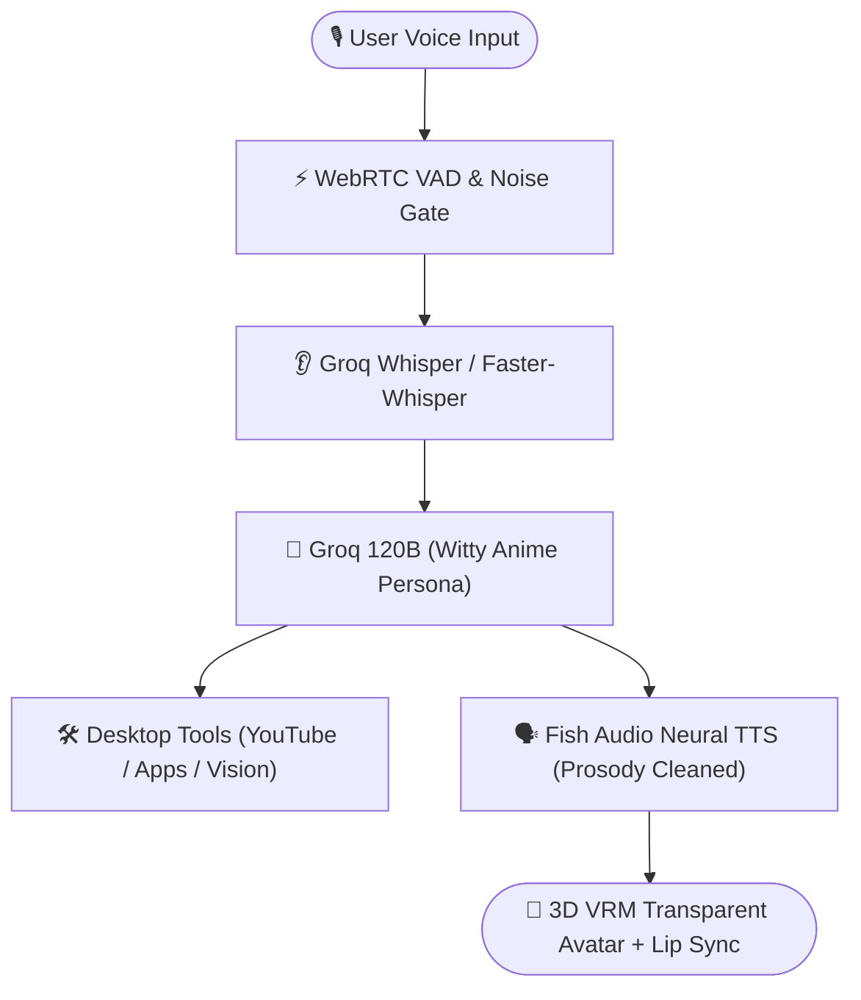

# 🌸 Riku - 3D AI Anime Desktop Companion & Voice Assistant

[](https://github.com/Utkarsh1087/Riku)
[](https://www.python.org/)
[](https://www.electronjs.org/)
[](LICENSE)

An intelligent, transparent, interactive 3D anime desktop companion that lives directly on your Windows desktop. Powered by **WebRTC VAD**, **Groq Whisper ASR**, **flagship LLMs (Groq 120B / OpenAI)**, **Fish Audio neural TTS**, and a **Three.js VRM avatar engine** featuring real-time lip synchronization, animations, vision, voice biometrics, system tools, and deadpan witty banter.

---

## ✨ Features

- 🪟 **Floating Transparent Desktop Pet**: Runs as a frameless, transparent, click-through capable Electron desktop companion with drag-and-drop physics, auto-grounding, and idle breathing animations.
- 🎙️ **Snappy WebRTC VAD Ears**: Real-time neural voice activity detection (WebRTC VAD Mode 2) with ultra-low latency silence cutoff (0.8s) and dynamic noise filtering.
- 🧠 **Dual Brain Architecture (Groq 120B & OpenAI)**: Powered by `openai/gpt-oss-120b` via Groq for instantaneous, witty, and contextual responses, with seamless fallback support.
- 🗣️ **Natural Acoustic TTS (No Singing Bug)**: High-fidelity voice synthesis via Fish Audio (`s2.1-pro`) with real-time prosody normalization to ensure crisp, human-like speech without melodic pitch glides.
- 💃 **3D VRM Lip-Sync & Emotion Engine**: Real-time phoneme lip-syncing and dynamic facial expressions (`[neutral]`, `[happy]`, `[angry]`, `[relaxed]`, `[surprised]`) synced with LLM sentiment.
- 👁️ **Computer Vision & Face ID**: Sees your screen or webcam on demand, recognizes your face, and guards your PC in autonomous security sentry mode.
- 🛠️ **Desktop Automation Tools**: Plays YouTube music, launches apps, adjusts volume, sets alarms, rolls dice, and manages long-term memory in a persistent profile diary.

---

## 🏗️ Architecture



---

## 🚀 Quick Start

### Prerequisites
- **Windows 10/11**
- **Python 3.11+** (managed via `uv`)
- **Node.js 18+** & npm
- Free API keys:
  - [Groq Cloud](https://console.groq.com/keys) (for fast 120B LLM & Whisper ASR)
  - [Fish Audio](https://fish.audio/) (for neural anime TTS)

### 1. Clone & Install Dependencies
```powershell
git clone https://github.com/Utkarsh1087/Riku.git
cd Riku

# Install Node dependencies
npm install

# Install Python environment & packages
uv sync
```

### 2. Configure Environment
Create a `.env` file in the root directory:
```env
GROQ_API_KEY=your_groq_api_key_here
FISH_API_KEY=your_fish_api_key_here
OPENAI_API_KEY=optional_openai_key
```

### 3. Launch Riku
Double-click `start_riko_pet.bat` or run:
```powershell
npm start
```

---

## 📦 Building the Installer
To generate the standalone Windows installer (`.exe`):
```powershell
npm run dist
```
The output executable will be generated inside `dist/`.

---

## ⚙️ Configuration
All personality traits, voice IDs, and parameters are defined in `character_config.yaml`:
- **Model**: Set LLM provider (`openai/gpt-oss-120b`, `gpt-4.1-mini`, etc.).
- **Voice**: Set Fish Audio voice model ID or local GPT-SoVITS checkpoint.
- **Avatar**: Load any custom `.vrm` 3D model placed inside `character_files/`.

---

## 📄 License
This project is licensed under the MIT License - see the [LICENSE](LICENSE) file for details.
